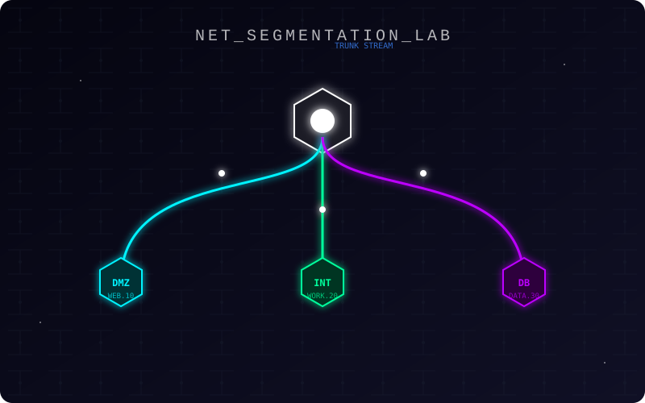

# Networking Lab: From Bridges to VLANs

Teaching material for a hands-on lab on network segmentation, written for technical high school students and their teachers: students build the same three-tier network twice with Incus containers, first with one bridge per network and then with 802.1Q VLANs on a single bridge.



---

## About The Project

The lab teaches the fundamentals of **Network Segmentation**. It is built on top of **Incus** (a system container manager) to simulate network hardware with lightweight Linux containers.

**What you will learn:**
1.  **Physical Segmentation (Legacy)**: How networks were separated using multiple physical interfaces and bridges.
2.  **Logical Segmentation (Modern)**: Moving to **VLANs (802.1Q)** and Trunking to run multiple networks on a single cable.
3.  **Services & Security**: Deploying a 3-tier architecture (Web DMZ, Internal Client, isolated Database) and configuring routing/NAT.

The lab is built by hand, one command at a time, so that every step can be studied; only the cleanup is scripted.

> **Note**: The detailed step-by-step lesson plan is available in Italian in [`lesson-plan.md`](lesson-plan.md).

---

## Architecture

The lab builds a classic 3-tier network topology:

*   **DMZ (VLAN 10, 10.10.1.0/24)**: Contains a Python Flask Web Server, the public-facing tier.
*   **Internal (VLAN 20, 10.10.2.0/24)**: Simulates an employee workstation.
*   **Database (VLAN 30, 10.10.3.0/24)**: A PostgreSQL database that accepts remote connections only from the DMZ subnet (trust authentication, no password, to keep the lab simple).
*   **Router**: An Alpine Linux container acting as the gateway/firewall for all networks, with NAT towards the Internet.

---

## Getting Started

This lab relies on **Incus**, which requires a Linux kernel with bridge and VLAN support.

### Linux (Native)
This is the recommended way to run the lab.

1.  **Install Incus**:
    Follow the [official instructions](https://linuxcontainers.org/incus/docs/main/installing/) for your distro (e.g., `sudo apt install incus` on Debian 13 or Ubuntu 24.04 and later).
    ```bash
    # Let your user manage Incus (then log in again, or run: newgrp incus-admin)
    sudo usermod -aG incus-admin "$USER"

    # Initialize Incus (accept defaults usually works)
    incus admin init
    ```

2.  **Clone this repo**:
    ```bash
    git clone https://github.com/Fede-Berga/networking-lab.git
    cd networking-lab
    ```

3.  **Run the Lab**:
    Follow [`lesson-plan.md`](lesson-plan.md) from the root of this repository (one of its commands copies `app/app.py` into the web server container). Part 1 builds the network with one bridge per segment; Part 2 deletes it and rebuilds it with VLANs on a single VLAN-aware bridge.

### Windows
Incus **does not run natively on Windows**. You must use a Linux VM or WSL2.

**Option A: WSL2 (Recommended)**
1.  Install a distro like Ubuntu 24.04 from the Microsoft Store.
2.  Ensure Systemd is enabled in WSL2 (Create `/etc/wsl.conf` with `[boot] systemd=true`).
3.  Follow the **Linux** instructions above inside your WSL terminal.

**Option B: Virtual Machine**
1.  Install VirtualBox, VMware, or Hyper-V.
2.  Create a Linux VM (Ubuntu Server recommended).
3.  Follow the **Linux** instructions inside the VM.

### macOS
Incus **does not run natively on macOS**. You need a Linux environment.

**Option A: OrbStack / Lima (Lightweight)**
1.  Install [OrbStack](https://orbstack.dev/) or `limactl`.
2.  Spin up a Linux machine.
3.  Follow the **Linux** instructions inside that machine.

**Option B: Virtual Machine**
1.  Use UTM or Parallels to run a Linux VM.
2.  Follow the **Linux** instructions inside the VM.

---

## Usage

Once the lab is running:

1.  **Verify Status**:
    ```bash
    incus list
    ```
    You should see `router`, `web-server`, `workstation`, and `database` running.

2.  **Test Connectivity**:
    From the internal workstation, check if you can reach the DMZ web app (the Alpine image does not include `curl`, so install it first):
    ```bash
    incus exec workstation -- apk add curl
    incus exec workstation -- curl http://10.10.1.10/health
    ```
    *Expected output: JSON response confirming connection to the Database.*

3.  **Cleanup**:
    To destroy the lab and free resources:
    ```bash
    sudo bash scripts/cleanup.sh
    ```
    The script starts with `incus stop --all`, which stops every running instance in the current Incus project, not only the lab's. It does not delete `db-net`, the database network of Part 1: if you stop after Part 1, remove it with `incus network delete db-net`.

## Project Structure

*   `app/`: Source code for the Flask Web Application (a home page and a `/health` endpoint that queries PostgreSQL).
*   `assets/`: The diagram at the top of this README.
*   `config/`: `gateway_firewall.nft`, an optional `nftables` ruleset for the router in the VLAN setup (the lesson plan itself uses `iptables`).
*   `scripts/`: `cleanup.sh`, which deletes the lab.
*   `lesson-plan.md`: **The core educational content (Italian)** explaining every command in detail.

---

## License

The code and the lesson material are licensed separately:

*   The lesson material ([`lesson-plan.md`](lesson-plan.md) and the diagram in [`assets/`](assets/)) is licensed under [Creative Commons Attribution 4.0 International](https://creativecommons.org/licenses/by/4.0/) (CC BY 4.0), see [`LICENSE-docs`](LICENSE-docs). You can reuse and adapt it, also in your own classes, as long as you credit Federico Bergamini.
*   Everything else, including the code in `app/`, `config/` and `scripts/`, is released under the [MIT License](LICENSE).
