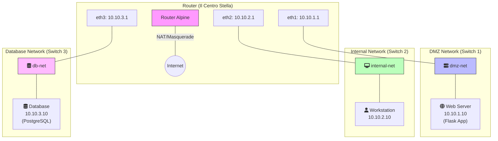
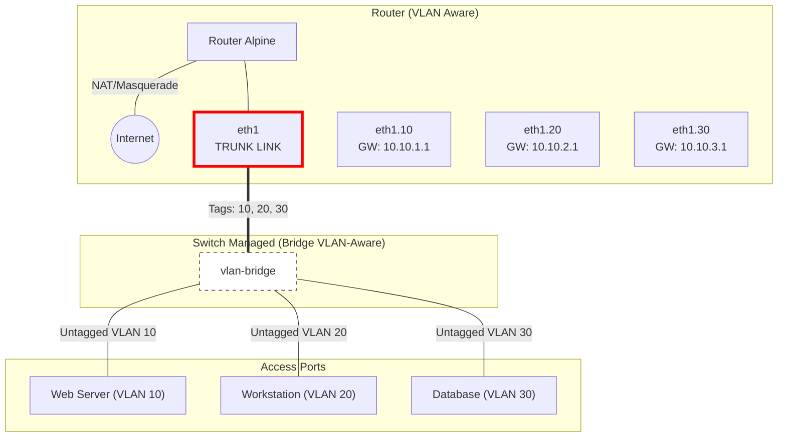

# 🎓 Masterclass Networking: Dai Bridge alle VLAN
*Una guida epica, passo dopo passo, per padroneggiare le reti virtuali con Incus.*

---

## 📅 Obiettivo della Lezione
In questa lezione non ci limiteremo a "copiare e incollare" comandi. Costruiremo, capiremo e testeremo due architetture di rete fondamentali, implementando **servizi reali** (Database e Web App) che devono parlarsi tra loro.

1.  **L'Approccio Fisico (Legacy)**: Costruiremo una rete usando switch separati per ogni dipartimento. È costoso, ingombrante, ma facile da visualizzare.
2.  **L'Approccio Logico (Moderno)**: Smantelleremo tutto e ricostruiremo la stessa infrastruttura usando un solo switch e la magia delle VLAN (802.1Q).

---

## 🛠️ PARTE 1: LA SOLUZIONE FISICA (BRIDGES)

> [!IMPORTANT]
> **Prerequisiti**: Assicurati di essere nella cartella corretta del terminale prima di iniziare!
> ```bash
> cd ~/Projects/work/School/5Ds/networking-lab
> ```
>
> 💡 **Tip (Visualizzazione Grafica)**: Se vuoi vedere i tuoi container e reti da un'interfaccia web, lancia questo comando all'inizio:
> ```bash
> # Avvia la UI in background
> nohup incus webui > webui.log 2>&1 &
>
> # Ottieni il link di accesso (clicca per aprire)
> grep "http" webui.log
> ```

*Immagina di avere 3 switch fisici sul tavolo. Ogni switch rappresenta una rete isolata. Per farli comunicare, abbiamo bisogno di un Router con 3 cavi, uno per ogni switch.*

### 📊 Architettura & Flusso Dati

Ecco cosa costruiremo. Nota come ogni rete è fisicamente separata.



---

### 1.1 Creazione dei "Cavi" (Bridges)
Creiamo 3 switch virtuali. Disattiviamo il NAT automatico perché configureremo il router manualmente!

```bash
# Rete DMZ (Pubblica) - Sarà 10.10.1.0/24
incus network create dmz-net ipv4.address=none ipv4.nat=false ipv6.address=none

# Rete Interna (Impiegati) - Sarà 10.10.2.0/24
incus network create internal-net ipv4.address=none ipv4.nat=false ipv6.address=none

# Rete Database (Privata/Sicura) - Sarà 10.10.3.0/24
incus network create db-net ipv4.address=none ipv4.nat=false ipv6.address=none

# 🔍 VERIFICA
# Controlla che le 3 reti esistano
incus network list --format table
```

### 1.2 Lancio delle Macchine
Creiamo i nostri computer con immagine Alpine Linux (leggera e veloce).

```bash
incus launch images:alpine/edge router
incus launch images:alpine/edge web-server
incus launch images:alpine/edge workstation
incus launch images:alpine/edge database

# 🔍 VERIFICA
# Controlla che i 4 container siano Running
incus list
```

### 1.3 Cablaggio Fisico (Connecting the Cables)
Colleghiamo le macchine agli switch giusti.

**Il Router (ha bisogno di 3 schede di rete, una per switch):**
```bash
incus network attach dmz-net router eth1
incus network attach internal-net router eth2
incus network attach db-net router eth3
```

**Gli Host (un cavo ciascuno):**
```bash
incus network attach dmz-net web-server eth0
incus network attach internal-net workstation eth0
incus network attach db-net database eth0

# 🔍 VERIFICA
# Controlla che il router abbia 4 interfacce (eth0 + 3 nuove)
incus exec router -- ip link show
```

### 1.4 Configurazione del Router (Il Cervello)
Il router deve avere un IP su ogni rete (Gateway) e permettere l'accesso a Internet per scaricare i pacchetti.

```bash
incus exec router -- sh -c '
    # 1. Abilita il forwarding (Routing tra le reti)
    sysctl -w net.ipv4.ip_forward=1
    
    # 2. Configura gli indirizzi IP dei Gateway
    ip addr add 10.10.1.1/24 dev eth1
    ip addr add 10.10.2.1/24 dev eth2
    ip addr add 10.10.3.1/24 dev eth3
    
    # 3. Accendi le interfacce
    ip link set eth1 up && ip link set eth2 up && ip link set eth3 up

    # 4. CONFIGURAZIONE INTERNET (NAT/Masquerade)
    # Senza questo, le VM interne non possono scaricare pacchetti da internet
    apk add iptables
    iptables -t nat -A POSTROUTING -o eth0 -j MASQUERADE
'

# 🔍 VERIFICA
# Controlla gli IP del router
incus exec router -- ip addr show
```

### 1.5 Configurazione dei Client (IP e Routing)
Diamo un'identità a ogni macchina e diciamo loro dov'è l'uscita (il Router).

```bash
# WEB SERVER (10.10.1.10)
incus exec web-server -- sh -c '
    ip addr add 10.10.1.10/24 dev eth0
    ip link set eth0 up
    ip route add default via 10.10.1.1
    # DNS Server (Google)
    echo "nameserver 8.8.8.8" > /etc/resolv.conf
'

# WORKSTATION (10.10.2.10)
incus exec workstation -- sh -c '
    ip addr add 10.10.2.10/24 dev eth0
    ip link set eth0 up
    ip route add default via 10.10.2.1
    echo "nameserver 8.8.8.8" > /etc/resolv.conf
'

# DATABASE (10.10.3.10)
incus exec database -- sh -c '
    ip addr add 10.10.3.10/24 dev eth0
    ip link set eth0 up
    ip route add default via 10.10.3.1
    echo "nameserver 8.8.8.8" > /etc/resolv.conf
'

> [!NOTE]

> **Nota sulla Persistenza**: Hai appena configurato gli IP manualmente con comando `ip`. Questa configurazione è **effimera**: se riavvii il container (`incus restart`), perderai IP e rotte. In un ambiente di produzione useremmo `/etc/network/interfaces`, ma qui vogliamo vedere *immediatamente* come funziona la rete!

# 🔍 VERIFICA
# Controlla che ogni macchina abbia il suo IP
incus exec web-server -- ip addr show eth0
incus exec workstation -- ip addr show eth0
incus exec database -- ip addr show eth0
```

### 1.6 🌍 TEST CONNETTIVITÀ INTERNET
Prima di installare i servizi, verifichiamo che il NAT funzioni.

```bash
incus exec web-server -- ping -c 3 google.com
incus exec database -- ping -c 3 google.com
```
> *Se i ping funzionano, il router sta facendo il suo lavoro di NAT tra le reti private e Internet!*

---

### 1.7 📦 Installazione e Configurazione Servizi

Ora costruiamo l'applicazione vera.

#### A. Il Database (PostgreSQL)
Il database deve accettare connessioni dalla rete del Web Server.

```bash
# 1. Installa PostgreSQL
incus exec database -- apk add postgresql

# 2. Prepara le cartelle
incus exec database -- sh -c 'mkdir /run/postgresql && chown postgres:postgres /run/postgresql'

# 3. Inizializza il DB
incus exec database -- su postgres -c "initdb -D /var/lib/postgresql/data"

# 4. CONFIGURA ACCESSO REMOTO
# Permetti connessioni da chiunque (filtreremo col firewall se necessario, o pg_hba)
incus exec database -- sh -c "echo \"listen_addresses = '*'\" >> /var/lib/postgresql/data/postgresql.conf"

# Fidati della rete DMZ (10.10.1.0/24)
incus exec database -- sh -c "echo 'host all all 10.10.1.0/24 trust' >> /var/lib/postgresql/data/pg_hba.conf"

# 5. Avvia il Database
incus exec database -- su postgres -c "pg_ctl start -D /var/lib/postgresql/data -l /var/lib/postgresql/data/logfile"

# 🔍 VERIFICA
# Controlla che Postgres sia in ascolto sulla porta 5432
incus exec database -- netstat -tuln | grep 5432
```

#### B. La Web App (Flask)
Il Web Server deve avere Python e l'app.

```bash
# 1. Installa dipendenze
# 1. Installa dipendenze (incluso screen)
incus exec web-server -- apk add python3 py3-flask py3-psycopg2 curl screen

# 2. Carica l'applicazione (Assicurati di essere nella cartella del repo!)
# Se sei nella home, spostati prima: cd ~/Projects/work/School/5Ds/networking-lab
incus file push app/app.py web-server/root/app.py

# 3. Avvia l'app in background (Metodo Nativo Alpine)
# start-stop-daemon è il tool standard di Alpine per i servizi.
# -S: Start, -b: Background, -m: Make pidfile
incus exec web-server -- start-stop-daemon -S -b -m -p /run/flask.pid -x /usr/bin/python3 -- /root/app.py

# 🔍 VERIFICA
# Controlla se il processo esiste
incus exec web-server -- ps aux | grep python
incus exec web-server -- netstat -tuln | grep 80
```

### 1.8 🧪 TEST DI CONNETTIVITÀ TOTALE (The Real Test)
Verifichiamo che tutta la catena funzioni: Workstation -> Web App -> Database.

```bash
# Dalla Workstation, chiamiamo l'API della Web App
incus exec workstation -- curl http://10.10.1.10/health
```

> **Risultato Atteso:**
> ```json
> {
>   "db_version": "PostgreSQL ...",
>   "message": "L'app DMZ è riuscita a parlare con il DB nascosto!",
>   "status": "CONNESSO"
> }
> ```
> Se vedi questo JSON, hai creato una rete a 3 livelli perfettamente funzionante! 🚀

### 1.9 🔓 Accesso dall'Esterno (Il tuo Mac) (Opzionale)
Vuoi vedere l'app dal browser del tuo Mac? Le reti sono isolate, quindi il tuo Mac non può raggiungere `10.10.1.10`.
Dobbiamo creare un "Tunnel" (Proxy) tramite Incus.

```bash
# Mappa la porta 8080 del tuo Mac (localhost) alla porta 80 del container Web
incus config device add web-server host-port80 proxy listen=tcp:0.0.0.0:8080 connect=tcp:127.0.0.1:80
```

Ora apri il browser (o usa curl) sul tuo Mac:
- **Dashboard**: [http://localhost:8080/](http://localhost:8080/)
- **Health Check**: [http://localhost:8080/health](http://localhost:8080/health)

---

## 🚀 PARTE 2: LA MIGRAZIONE ALLE VLAN (LOGICA)

*Ora renderemo tutto più efficiente. Un solo switch, un solo cavo per il router, ma le stesse tre reti isolate logicamente.*

### 📊 Architettura Logical & Trunking



### 🧠 Perché funziona? La Magia delle VLAN
Ecco cosa succede "sotto il cofano" quando lanci questi comandi:
1.  **Sul Router (`eth1.10`)**: Il router aggiunge un'etichetta "**Tag 10**" ai pacchetti che escono per il Web Server.
2.  **Sullo Switch (`vlan-bridge`)**: Incus legge il tag. Cerca una porta configurata per la VLAN 10.
3.  **Sulla Porta del Container (`vlan=10`)**: Incus rimuove l'etichetta (**untag**) prima di consegnare il pacchetto al container.
4.  **Risultato**: Il `web-server` non sa nemmeno che le VLAN esistono! Riceve un normale pacchetto Ethernet. *Questo è esattamente come funzionano le reti Enterprise.*

### 2.1 Tabula Rasa (Cleanup)
Cancelliamo tutto per ricominciare da zero (e dimostrare che non stiamo barando!).
```bash
incus stop --all
incus delete --force router web-server workstation database
incus network delete dmz-net internal-net db-net
```

### 2.2 Il Bridge VLAN-Aware
```bash
# Nota: vlan.filtering=true è fondamentale!
incus network create vlan-bridge ipv4.address=none ipv4.nat=false ipv6.address=none vlan.filtering=true
```

### 2.3 Router e Trunking
Colleghiamo il router. Notare che non specifichiamo nessuna VLAN nell'attach: default è Trunk (tutte le VLAN passano).

```bash
incus launch images:alpine/edge router
incus network attach vlan-bridge router eth1

# Configurazione Router "Router-on-a-Stick"
incus exec router -- sh -c '
    apk add iptables
    sysctl -w net.ipv4.ip_forward=1
    iptables -t nat -A POSTROUTING -o eth0 -j MASQUERADE
    modprobe 8021q
    ip link set eth1 up

    # VLAN 10 (DMZ)
    ip link add link eth1 name eth1.10 type vlan id 10
    ip addr add 10.10.1.1/24 dev eth1.10
    ip link set eth1.10 up

    # VLAN 20 (Internal)
    ip link add link eth1 name eth1.20 type vlan id 20
    ip addr add 10.10.2.1/24 dev eth1.20
    ip link set eth1.20 up

    # VLAN 30 (Database)
    ip link add link eth1 name eth1.30 type vlan id 30
    ip addr add 10.10.3.1/24 dev eth1.30
    ip link set eth1.30 up
    ip link set eth1.30 up
'

# 🔍 VERIFICA
# Controlla le sotto-interfacce create
incus exec router -- ip link show
```

### 2.4 Host su Access Ports
Qui diciamo allo switch: "Tutto ciò che entra da questa porta appartiene alla VLAN X".

```bash
# Web Server (VLAN 10)
incus launch images:alpine/edge web-server
incus network attach vlan-bridge web-server eth0
incus config device set web-server eth0 vlan=10

# Workstation (VLAN 20)
incus launch images:alpine/edge workstation
incus network attach vlan-bridge workstation eth0
incus config device set workstation eth0 vlan=20

# Database (VLAN 30)
incus launch images:alpine/edge database
incus network attach vlan-bridge database eth0
incus config device set database eth0 vlan=30

# 🔍 VERIFICA
# Controlla che le VLAN siano assegnate (non visibile facilmente da host, ma da config incus)
incus config show web-server | grep vlan
```

### 2.5 Configurazione IP Host
Identica alla Parte 1. La logica VLAN è trasparente all'OS dell'host!

```bash
# Web Server
incus exec web-server -- sh -c 'ip addr add 10.10.1.10/24 dev eth0; ip link set eth0 up; ip route add default via 10.10.1.1; echo "nameserver 8.8.8.8" > /etc/resolv.conf'

# Workstation
incus exec workstation -- sh -c 'ip addr add 10.10.2.10/24 dev eth0; ip link set eth0 up; ip route add default via 10.10.2.1; echo "nameserver 8.8.8.8" > /etc/resolv.conf'

# Database
incus exec database -- sh -c 'ip addr add 10.10.3.10/24 dev eth0; ip link set eth0 up; ip route add default via 10.10.3.1; echo "nameserver 8.8.8.8" > /etc/resolv.conf'
```

### 2.6 Re-deploy dei Servizi & Test Finale
Reinstalliamo velocemente l'app per verificare che le VLAN stiano trasportando i dati correttamente.

```bash
# DB Setup
incus exec database -- apk add postgresql
incus exec database -- sh -c 'mkdir /run/postgresql && chown postgres:postgres /run/postgresql'
incus exec database -- su postgres -c "initdb -D /var/lib/postgresql/data"
incus exec database -- sh -c "echo \"listen_addresses = '*'\" >> /var/lib/postgresql/data/postgresql.conf"
incus exec database -- sh -c "echo 'host all all 10.10.1.0/24 trust' >> /var/lib/postgresql/data/pg_hba.conf"
incus exec database -- su postgres -c "pg_ctl start -D /var/lib/postgresql/data -l /var/lib/postgresql/data/logfile"

# Web Setup
incus exec web-server -- apk add python3 py3-flask py3-psycopg2 screen
incus file push app/app.py web-server/root/app.py
# 3. Avvia con start-stop-daemon
incus exec web-server -- start-stop-daemon -S -b -m -p /run/flask.pid -x /usr/bin/python3 -- /root/app.py

# 🔍 VERIFICA
incus exec web-server -- ps aux | grep python

# VERIFICA FINALE
incus exec workstation -- curl http://10.10.1.10/health
```

### 🔒 Bonus: Sicurezza
Se vuoi isolare il DB da internet ORA che hai installato tutto:
```bash
# Sul Router: blocca traffico da VLAN 30 verso Internet
incus exec router -- iptables -I FORWARD -i eth1.30 -o eth0 -j DROP
```
Adesso `incus exec database -- ping google.com` fallirà, ma `curl` dalla workstation continuerà a funzionare!

**Missione Compiuta.** Hai creato una rete Software-Defined sicura, scalabile e funzionante. 🏆
